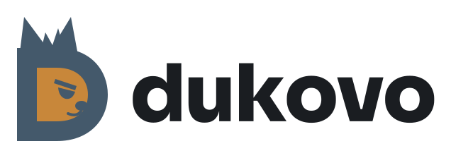

<!--
SPDX-FileCopyrightText: 2026 The Dukovo contributors
SPDX-License-Identifier: Apache-2.0 OR MIT
-->

<div align="center">

<picture>
  <source media="(prefers-color-scheme: dark)" srcset="docs/images/dukovo-logo-dark.svg">
  
</picture>

**A bright future. A human future.**

An operating system built on **Radix**, a capability kernel written in Rust.

[](https://github.com/dukovo-os/dukovo/actions/workflows/ci.yml)
[](https://github.com/dukovo-os/dukovo/actions/workflows/bench.yml)


[Website](https://dukovo.org) ·
[Handbook](docs/handbook/src/introduction.md) ·
[Roadmap](docs/roadmap.md) ·
[Architecture](ARCHITECTURE.md) ·
[Contributing](CONTRIBUTING.md)

</div>

---

Dukovo is a new operating system with security, speed and the person in
front of it at its core. Every program reaches only what it was given:
files, devices and the network sit behind unforgeable capabilities that
no account, root included, can get around. The kernel is written in
Rust, checked by Kani proofs and TLA+ models, and measured against Linux
on every change.

Release 1.0 is a headless **server** system, in the spirit of Ubuntu
Server, run from the Nukesh shell or the **Dukovo Admin** web console.
The window manager (`windowd`) and the desktop follow from release 1.1
([ADR 0078](docs/adr/0078-server-first-release.md)).

> [!NOTE]
> Dukovo is under active development and has no public release yet. The
> first public release will be 1.0.0, a beta for full testing.

## Highlights

| | |
| --- | --- |
| **Capability security** | Every file, device and socket is reached through a capability. Apps run sealed in sandboxes, and a permission prompt that no program can draw asks before they get more. |
| **As fast as Linux, or faster** | CI runs every kernel and POSIX operation it measures against Linux in the same virtual machine, and fails if Radix is slower at any of them. |
| **Your data, safe** | Btrfs is the native file system, written from the specification in Rust, with snapshots, compression and RAID1 or RAID10 mirroring. FAT, exFAT, ext4 and NTFS disks read and write too. |
| **Familiar from day one** | Nukesh runs bash scripts and serves as `/bin/sh`, with the commands of a Linux server and a man page for every command and file format. |
| **Plays well with others** | SSH, SMB and NFS file sharing with Windows and Linux machines, WireGuard, IPv6, and C and Rust programs ported from Linux through mlibc and Rust's standard library. |
| **Yours, and private** | No telemetry, no accounts in the cloud, and no age or identity checks, ever. Nothing leaves the machine unless you start it ([privacy](docs/handbook/src/privacy.md)). |

## Status

Phases 0 to 13 of the [roadmap](docs/roadmap.md) are done; Phase 14 is
under way. Each phase ends in something that boots and is tested in QEMU,
and on real machines in the project's test lab.

| Phase | What it brings | Status |
| --- | --- | --- |
| 0 to 9 | Boot, memory, capabilities, scheduling, IPC, processes, files, POSIX, the Nukesh shell and its tools | Done |
| 10 | Native storage: Btrfs, NVMe, AHCI and swap | Done |
| 11 | USB, input, power, IOMMUs, NTFS and removable media | Done; memory cards and optical drives under way |
| 12 | Networking, IPv6, the firewall and WireGuard | Done |
| 13 | Users, SSH, bundles, the catalog, logging and file sharing | Done |
| 14 | The installer, `rdisk`, USB media and cloud images | Under way |
| 15 | Atomic updates and snapshots | Planned |
| 16 | Server platform and the Dukovo Admin web console | Planned |
| 17 | Go toolchain | Planned |
| 18 | Linux containers through Podman: **Release 1.0** | Planned |

After 1.0, releases 1.1 to 1.18 add the desktop, the UI kit and
Store, Linux desktop apps, developer tools, a local AI assistant, gaming,
and AArch64 and RISC-V. Then Dukovo is 2.0.

## Quick start

You need an x86-64 Linux machine. Everything else is checked for you.

```sh
git clone https://github.com/dukovo-os/dukovo
cd dukovo
./ob setup     # installs the pinned Rust toolchain, then lists any missing tools
./ob run       # builds the kernel and boot image, then boots it in QEMU
```

`./ob doctor` prints the exact command that installs anything missing on
Debian, Ubuntu, Fedora or Arch Linux. On macOS, Windows or another
distribution, put `--container` in front of any command to run it inside
the pinned build container with Podman or Docker:

```sh
./ob --container test
```

## The `ob` build tool

| Command | What it does |
| --- | --- |
| `./ob setup` | Install the pinned Rust toolchain, then run `doctor` and `crates` |
| `./ob doctor` | Check host tools and print the commands that install what is missing |
| `./ob build` | Build the kernel, with its symbol table, into `out/sysroot/` |
| `./ob ports` | Build the software Dukovo ports from elsewhere (mlibc, Rust's standard library, Lua and the rest) at their pinned commits |
| `./ob crates` | Fetch the crates.io crates the kernel patches (smoltcp) and patch them into `kernel/patched/` |
| `./ob image` | Build the hybrid USB/disk image `out/dukovo-<version>-x86_64.img` (`--iso` for an ISO, `--installed` for an installed disk, `--lab` for a lab image) |
| `./ob run` | Boot the image in QEMU with the serial console in your terminal (`--bios`, `--media usb\|cdrom\|disk`, `--gdb`, `--cmdline`) |
| `./ob test` | Run unit tests, then the boot tests in QEMU, from the boot paths and the memory manager to processes, storage and POSIX (`kani` for the Kani proofs, `tla` for the TLA+ models, `tuf` for the TUF conformance suite, `corpus` for the shell corpus, `riscv` for the RISC-V smoke boot) |
| `./ob lab` | Build a lab image and run the lab's tests on it, in QEMU or on the lab's machines |
| `./ob bench` | Measure kernel operations against Linux in the same virtual machine (`--gate` fails if Radix is slower; `--instructions` counts instructions per operation; `--shell` and `--scaling` add the shell and multi-core rows) |
| `./ob catalog` | Sign and publish the bundle catalog with its YubiKeys, and set up the update server |
| `./ob docs` | Build the man pages and the handbook into `out/docs/` (`--check` for completeness checks) |
| `./ob lint` / `./ob fmt` | Check or apply formatting, and run Clippy with warnings denied |
| `./ob signoff` | Check that your new commits carry a Developer Certificate of Origin sign-off |
| `./ob clean` | Remove build output |

Settings live in [`dukovo.toml`](dukovo.toml). The full manual is
[`ob(1)`](docs/man/ob.1.scd); after `./ob docs`, read it with
`man -l out/docs/man/man1/ob.1`.

## Writing the image to a USB stick

```sh
./ob image
lsblk -d -o NAME,SIZE,MODEL,TRAN          # find your stick, for example sdb
sudo dd if=out/dukovo-0.14.1-x86_64.img of=/dev/sdX bs=4M conv=fsync status=progress
```

Everything on the target device is erased. balenaEtcher, GNOME Disks
("Restore Disk Image") and Rufus in DD mode write the same image. The
handbook chapter [Creating USB install media](docs/handbook/src/usb-media.md)
covers booting it on real hardware.

## Repository layout

```
ob                  build entry point (shell wrapper around tools/xtask)
dukovo.toml         build configuration, see dukovo.toml(5)
rust-toolchain.toml pinned nightly Rust
abi/                the system call interface, in RIDL (see radix-ipc(7))
kernel/             the Radix kernel workspace
  radix/            the kernel binary: boot, consoles, panic, kdb, threads,
                    user mode, system calls, IPC objects, files and the POSIX
                    layer
  hal/              hardware abstraction layer traits, kernel command line
  arch/             x86_64 (boot, CPU tables, paging, ACPI, APIC, SMP, system
                    call entry), with aarch64 stubs and a riscv64 smoke boot
  mm/, cap/, sched/ the memory manager, capability store and scheduling policy
  ipc/              IPC arithmetic: info words, user ranges, ring accounting
  fs/               the block layer, the VFS and the file systems: Btrfs, FAT,
                    exFAT, ext4, NTFS, ISO 9660, UDF, BitLocker and FUSE
  net/              the network stack on smoltcp, the firewall and sockets
  drivers/          storage (NVMe, AHCI, USB, SD cards), network cards, USB
                    host controllers, IOMMUs, I2C, sensors and virtio
  lib/              host-tested kernel libraries: ACPI and uACPI, ELF, the
                    POSIX layer, the TTY, kdb, the lock checker and more
  abi/              radix-abi, the Rust bindings generated from abi/
  targets/          the kernel's Rust target specification
userspace/          the user programs: libradix, radix-rt, Spark and the tests;
                    programs/ holds Nukesh, systools, sshd, smbd, nfsd, the
                    installer, the account, bundle and catalog tools
ports/              software from elsewhere at pinned commits, with patches
catalog/            the signed metadata of the bundle catalog (TUF)
lab/                the tests the real-hardware lab runs
credits/            one file per credited project, merged into CREDITS.md
image/              GRUB menu template and license files for every image
docs/
  man/              man pages (scdoc sources)
  handbook/         user handbook (mdBook)
  adr/              architecture decision records
  design/           design notes on how the kernel works
  roadmap.md        the implementation plan, from Phase 0 to release 2.0
tools/xtask/        the Rust program behind ./ob
tools/ridlc/        the interface compiler: abi/ to Rust, C and man(2)
tools/linux-bench/  the Linux baseline for ./ob bench
tools/container/    the pinned build container
tools/update-server/ setup for the update server
```

## Documentation

| Where | What |
| --- | --- |
| [Handbook](docs/handbook/src/SUMMARY.md) | How to build, install and use Dukovo, chapter by chapter |
| [Man pages](docs/man/) | Every command, file format, service and system call; `./ob docs` builds them |
| [Architecture](ARCHITECTURE.md) | A one-page map of the code |
| [Design notes](docs/design/) | How the kernel works: memory, scheduling, IPC, capabilities, storage and POSIX |
| [Decision records](docs/adr/README.md) | Why each part of Dukovo is the way it is |
| [Roadmap](docs/roadmap.md) | The plan, phase by phase, to 1.0 and on to 2.0 |

## Contributing

Start with [ARCHITECTURE.md](ARCHITECTURE.md), a map of the code, then read
[CONTRIBUTING.md](CONTRIBUTING.md) and the
[coding standard](docs/coding-standard.md). Every commit is signed off under
the [Developer Certificate of Origin](CONTRIBUTING.md#developer-certificate-of-origin),
and everyone taking part follows the [code of conduct](CODE_OF_CONDUCT.md).
[GOVERNANCE.md](GOVERNANCE.md) says who decides what, and
[SECURITY.md](SECURITY.md) how to report a vulnerability privately.
Decisions that shape the system are recorded as
[architecture decision records](docs/adr/README.md).

Every decision follows the project's
[guiding principle](GOVERNANCE.md#guiding-principle-favor-the-user): at a
fork in the road, Dukovo favors the user. Freedom is at the core of its
philosophy, and the user owns the machine.

## License

Dukovo is licensed under either of

- Apache License, Version 2.0 ([LICENSE-APACHE](LICENSE-APACHE))
- MIT license ([LICENSE-MIT](LICENSE-MIT))

at your option. Unless you explicitly state otherwise, any contribution
intentionally submitted for inclusion in Dukovo by you, as defined in the
Apache-2.0 license, shall be dual licensed as above, without any additional
terms or conditions.

Some files come from other projects under their own licenses, such as the
console fonts (BSD-2-Clause). Every file names its copyright holders and
license, following the [REUSE specification](https://reuse.software/), and
`LICENSES/` holds the license texts. [CREDITS.md](CREDITS.md) thanks the
projects Dukovo is built on.

The Dukovo name and logo are the project's marks and are not covered by
these licenses; the [trademark policy](TRADEMARKS.md) says how they may be
used, and [`LICENSES/LicenseRef-Dukovo-Marks.txt`](LICENSES/LicenseRef-Dukovo-Marks.txt)
covers the logo's files.
